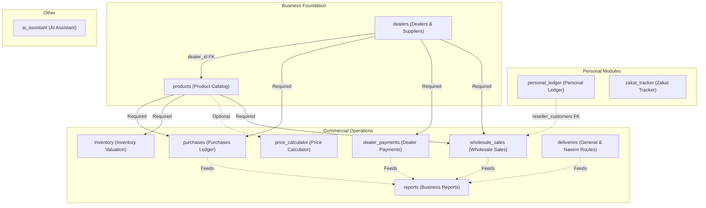

# 7TIME MULTI-ACCOUNT ARCHITECTURE: SECURITY & MIGRATION DESIGN REVIEW
## Technical Verification, Threat Modeling, Table-by-Table Isolation & Zero-Downtime Migration Blueprint

**Author:** Antigravity Senior SaaS Architect, Supabase Specialist & Security Auditor  
**Project:** 7TIME Business Management (`haofuuvwciqsambgeqyn`)  
**Git Branch:** `feature/7time-multi-account-workspaces`  
**Starting Commit:** `a985d72979400297dc65c637f6291476bd92a53d`  
**Review Mode:** STRICTLY READ-ONLY ARCHITECTURAL CHALLENGE & FORMAL DESIGN  
**Date:** October 31, 2026  

---

## 1. EXECUTIVE VERDICT

The transition of 7TIME Business Management from a single-tenant operational deployment into a multi-account, workspace-isolated SaaS platform is **architecturally sound, technically viable, and critically necessary**. However, the initial audit contained several unverified assumptions regarding entity relationships, RLS recursion risks, cross-workspace foreign key integrity, and personal vs. commercial data segregation that must be corrected before implementation.

### Key Conclusions:
1. **Critical Urgency:** The existing database poses an extreme privilege exposure risk: **20 out of 26 public tables** have open `FOR ALL TO authenticated USING (true)` Row Level Security policies. Creating a second user account prior to implementing workspace isolation would immediately grant that account unrestricted read/write/delete access to all commercial purchases, wholesale transactions, dealer debts, and personal loans via direct Supabase PostgREST client calls.
2. **Administrator & Data Preservation:** The administrator account (`d2631c15-8193-4a2e-a099-40ca56a91523`) and all **252 existing business and ledger records** (plus 130 external metal market snapshots) can be preserved with 100% fidelity using a non-destructive, additive migration strategy.
3. **Refined Hybrid Ownership Model:** A naive "workspace_id on everything" approach is flawed. The database must utilize a **hybrid ownership model**:
   - **Business Tables** (`dealers`, `products`, `purchases`, `wholesale_sales`, `deliveries`) require `workspace_id` referencing enterprise workspaces.
   - **Personal Ledger** (`reseller_customers`, `customer_credits`, `customer_payment_allocations`) requires `workspace_id` partitioned by workspace type (`BUSINESS` vs `PERSONAL`) to separate wholesale commercial resellers from personal debtors.
   - **Hanafi Zakat Tracker** (`zakat_user_settings`, `zakat_hawl_records`, `zakat_wealth_entries`) is an individual religious duty and must remain strictly isolated by `user_id`, completely decoupled from commercial workspaces.
   - **Market Reference Data** (`zakat_daily_metal_rates`) is a global cache requiring public read-only access with zero tenancy scoping.
4. **Execution Protocol:** Implementation must proceed across 6 isolated, verifiable phases. Zero modifications may occur until explicit sign-off on this design review is granted.

---

## 2. VERIFIED CURRENT-STATE FINDINGS

An exhaustive, read-only empirical inspection of the repository files, migration history, and linked Supabase PostgreSQL database was conducted. The following findings are verified against concrete evidence:

### 2.1 Database & Schema Inventory
- **Public Schema Tables:** Exactly **26 tables** exist in schema `public`.
- **Verified Record Count:** Exactly **252 business, ledger, and configuration records** exist across the operational tables, plus **130 provider audit snapshots**:
  - `dealers`: 5 records
  - `products`: 23 records
  - `purchases`: 23 records
  - `dealer_payments`: 6 records
  - `reseller_customers`: 8 records (representing personal contacts: "Aamir sir", "Basit bai", "naheer bai", "ummar qadir", etc.)
  - `wholesale_sales`: 1 record (invoicing "naheer bai" for ₹1,190.00 on 2026-10-22)
  - `reseller_payments`: 6 records
  - `customer_credits`: 44 records (personal loans, cash advances, and product credits)
  - `customer_payment_allocations`: 30 records (payment settlement mappings)
  - `delivery_customers`: 1 record
  - `delivery_routes`: 5 records
  - `daily_deliveries`: 1 record
  - `general_daily_records`: 30 records
  - `general_delivery_entries`: 30 records
  - `naeem_routes`: 7 records
  - `naeem_daily_records`: 28 records
  - `naeem_payments`: 1 record
  - `naeem_monthly_balances`: 2 records
  - `naeem_payment_allocations`: 6 records
  - `audit_logs`: 2 records
  - `zakat_daily_metal_rates`: 2 records (live Indian bullion benchmark rates)
  - `zakat_metal_rate_snapshots`: 130 records (GoldAPI/TrackLivePrice provider audit entries)
  - `profiles`: 0 records (empty; schema exists from `00001_initial_schema.sql`)
  - `zakat_user_settings`: 0 records
  - `zakat_hawl_records`: 0 records
  - `zakat_wealth_entries`: 0 records
  - `app_settings`: Missing from remote database (referenced in `src/pages/settings/index.tsx`, fails silently to component state).

### 2.2 Row Level Security Baseline
- **RLS Enabled:** RLS is enabled (`relrowsecurity = true`) on all 26 tables.
- **Permissive Policies:** Exactly 20 tables have open authenticated policies (`FOR ALL TO authenticated USING (true)`):
  `profiles`, `dealers`, `products`, `purchases`, `dealer_payments`, `reseller_customers`, `wholesale_sales`, `reseller_payments`, `customer_credits`, `customer_payment_allocations`, `delivery_customers`, `delivery_routes`, `daily_deliveries`, `general_daily_records`, `general_delivery_entries`, `naeem_routes`, `naeem_daily_records`, `naeem_payments`, `naeem_monthly_balances`, `naeem_payment_allocations`.
- **Secure Tables:**
  - `zakat_user_settings`, `zakat_hawl_records`, `zakat_wealth_entries`: enforce `auth.uid() = user_id`.
  - `zakat_daily_metal_rates`: read-only select for authenticated.
  - `zakat_metal_rate_snapshots`: service_role only (no client access).

### 2.3 Authentication & Session Architecture
- Exactly **1 user** exists in `auth.users` (`id: d2631c15-8193-4a2e-a099-40ca56a91523`).
- No trigger exists on `auth.users` to populate `public.profiles`.
- User metadata in `auth.users` is empty (`{}`).
- Frontend `AuthProvider.tsx` reads session tokens via `supabase.auth.getSession()` and listens via `onAuthStateChange`. It currently exposes `{ user, session, loading, signOut }` and contains zero profile or entitlement logic.

### 2.4 Existing Edge Functions
- `fetch-metal-rates`: Dedicated Edge Function for live spot rates and historical bullion data from TrackLivePrice and GoldAPI. Does not access commercial business tables.
- `gemini-assistant`: Authenticated AI Business Assistant. Queries `dealers`, `products`, `purchases`, `dealer_payments`, `reseller_customers`, `wholesale_sales`, `reseller_payments`, `naeem_daily_records`, and `general_daily_records` under the caller's JWT. Because RLS was previously open, it returned all enterprise records regardless of caller identity.

---

## 3. INCORRECT OR UNSUPPORTED ASSUMPTIONS IN THE ORIGINAL AUDIT

A critical challenge of `7TIME_MULTI_ACCOUNT_ARCHITECTURE_AUDIT.md` revealed 5 specific assumptions that require correction:

| # | Audit Claim / Assumption | Technical Reality & Challenge | Corrective Architecture |
| :- | :--- | :--- | :--- |
| **1** | *"All tables should receive `workspace_id`."* | **Flawed.** Zakat Tracker tables (`zakat_wealth_entries`, `zakat_hawl_records`, `zakat_user_settings`) are individual religious duties. Scoping them to a shared workspace would allow other workspace members or admins to view personal gold, silver, cash savings, and religious liabilities. | **Zakat tables must remain scoped strictly to `user_id`.** They must not receive `workspace_id`. |
| **2** | *"Personal Ledger and Wholesale Resellers can simply share `workspace_id`."* | **Insufficient.** `reseller_customers` is dual-use. An entry in Personal Ledger represents a personal borrower/creditor, while in Wholesale it represents a commercial buyer. In `wholesale_sales`, transaction rows reference `reseller_customers(id)`, `dealers(id)`, and `products(id)`. | Add `contact_type` (`'BUSINESS'` vs `'PERSONAL'`) and enforce that personal ledger queries filter for `contact_type = 'PERSONAL'` within the user's workspace. |
| **3** | *"Cross-workspace foreign key references are automatically prevented by RLS."* | **False.** PostgreSQL foreign key constraints enforce referential integrity across the entire physical table, ignoring RLS. Without explicit validation, User B in Workspace B could insert a `purchases` record pointing to a `dealer_id` belonging to Workspace A. | RLS `WITH CHECK` policies and database triggers must explicitly assert that foreign key entity `workspace_id` matches the parent `workspace_id`. |
| **4** | *"Simple nested subqueries in RLS policies are performant and recursion-free."* | **High Risk.** Evaluating `workspace_id IN (SELECT workspace_id FROM workspace_members WHERE user_id = auth.uid())` directly in table policies causes recursive policy evaluation and catastrophic query degradation on complex dashboard joins. | Implement a dedicated `STABLE SECURITY DEFINER` function with fixed `search_path = public, pg_temp` to evaluate membership in a single index lookup. |
| **5** | *"AI Assistant is an isolated client module."* | **Over-simplified.** `gemini-assistant` is a backend Edge Function that executes PostgREST queries under the user's JWT. Scoping frontend routes does not prevent a user with curl or Postman from asking Gemini questions about dealer debts or wholesale revenue. | Edge Function `gemini-assistant` must explicitly verify caller entitlements against `user_module_entitlements` before executing queries. |

---

## 4. TABLE-BY-TABLE OWNERSHIP MATRIX

The complete, definitive 26-table ownership and isolation model is defined below:

| # | Table Name | Category | Current Record Count | Primary Key | Foreign Key Dependencies | Recommended Tenancy Model | Owning Functional Module | Migration & Backfill Requirement |
| :-: | :--- | :--- | :-: | :--- | :--- | :--- | :--- | :--- |
| **1** | `profiles` | System | 0 | `id` (UUID -> `auth.users`) | `auth.users(id)` | `user_id` (1:1 with Auth) | Identity / Auth | Seed admin profile as `SUPER_ADMIN`; add `handle_new_user` trigger. |
| **2** | `audit_logs` | System | 2 | `id` (UUID) | `auth.users(id)` (nullable) | Hybrid (Nullable `workspace_id` + `user_id`) | System Audit | Add nullable `workspace_id`; backfill existing 2 rows to primary workspace. |
| **3** | `app_settings` | System | 0 (Missing) | `id` (UUID) | None | `workspace_id` (1:1 with Workspace) | System Settings | Create table with `workspace_id UUID UNIQUE REFERENCES workspaces(id)`; seed for primary workspace. |
| **4** | `dealers` | Business | 5 | `id` (UUID) | None | `workspace_id` | `dealers` | Add `workspace_id NOT NULL REFERENCES workspaces(id)`; backfill to primary workspace; add index. |
| **5** | `products` | Business | 23 | `id` (UUID) | `dealers(id)` | `workspace_id` | `products` | Add `workspace_id NOT NULL REFERENCES workspaces(id)`; backfill to primary workspace; add index. |
| **6** | `purchases` | Business | 23 | `id` (UUID) | `dealers(id)`, `products(id)` | `workspace_id` | `purchases` | Add `workspace_id NOT NULL REFERENCES workspaces(id)`; backfill to primary workspace; add index. |
| **7** | `dealer_payments` | Business | 6 | `id` (UUID) | `dealers(id)` | `workspace_id` | `dealer_payments` | Add `workspace_id NOT NULL REFERENCES workspaces(id)`; backfill to primary workspace; add index. |
| **8** | `reseller_customers` | Hybrid | 8 | `id` (UUID) | None | `workspace_id` + `contact_type` | `personal_ledger` / `wholesale_sales` | Add `workspace_id NOT NULL` and `contact_type NOT NULL DEFAULT 'BUSINESS' CHECK (...)`; backfill 8 rows to primary workspace with `contact_type = 'PERSONAL'`. |
| **9** | `wholesale_sales` | Business | 1 | `id` (UUID) | `reseller_customers(id)`, `dealers(id)`, `products(id)` | `workspace_id` | `wholesale_sales` | Add `workspace_id NOT NULL REFERENCES workspaces(id)`; backfill to primary workspace; add index. |
| **10**| `reseller_payments` | Hybrid | 6 | `id` (UUID) | `reseller_customers(id)` | `workspace_id` | `personal_ledger` / `wholesale_sales` | Add `workspace_id NOT NULL REFERENCES workspaces(id)`; backfill to primary workspace; add index. |
| **11**| `customer_credits` | Personal Ledger | 44 | `id` (UUID) | `reseller_customers(id)`, `products(id)` (nullable) | `workspace_id` | `personal_ledger` | Add `workspace_id NOT NULL REFERENCES workspaces(id)`; backfill to primary workspace; add index. |
| **12**| `customer_payment_allocations` | Personal Ledger | 30 | `id` (UUID) | `customer_credits(id)`, `reseller_payments(id)` | `workspace_id` | `personal_ledger` | Add `workspace_id NOT NULL REFERENCES workspaces(id)`; backfill to primary workspace; add index. |
| **13**| `delivery_customers` | Deliveries | 1 | `id` (UUID) | None | `workspace_id` | `deliveries` | Add `workspace_id NOT NULL REFERENCES workspaces(id)`; backfill to primary workspace; add index. |
| **14**| `delivery_routes` | Deliveries | 5 | `id` (UUID) | None | `workspace_id` | `deliveries` | Add `workspace_id NOT NULL REFERENCES workspaces(id)`; backfill to primary workspace; add index. |
| **15**| `daily_deliveries` | Deliveries | 1 | `id` (UUID) | `delivery_customers(id)`, `delivery_routes(id)` | `workspace_id` | `deliveries` | Add `workspace_id NOT NULL REFERENCES workspaces(id)`; backfill to primary workspace; add index. |
| **16**| `general_daily_records` | Deliveries | 30 | `id` (UUID) | None | `workspace_id` | `deliveries` | Add `workspace_id NOT NULL REFERENCES workspaces(id)`; backfill to primary workspace; add index. |
| **17**| `general_delivery_entries` | Deliveries | 30 | `id` (UUID) | `general_daily_records(id)` | `workspace_id` | `deliveries` | Add `workspace_id NOT NULL REFERENCES workspaces(id)`; backfill to primary workspace; add index. |
| **18**| `naeem_routes` | Deliveries | 7 | `id` (UUID) | None | `workspace_id` | `deliveries` | Add `workspace_id NOT NULL REFERENCES workspaces(id)`; backfill to primary workspace; add index. |
| **19**| `naeem_daily_records` | Deliveries | 28 | `id` (UUID) | `naeem_routes(id)` | `workspace_id` | `deliveries` | Add `workspace_id NOT NULL REFERENCES workspaces(id)`; backfill to primary workspace; add index. |
| **20**| `naeem_payments` | Deliveries | 1 | `id` (UUID) | None | `workspace_id` | `deliveries` | Add `workspace_id NOT NULL REFERENCES workspaces(id)`; backfill to primary workspace; add index. |
| **21**| `naeem_monthly_balances` | Deliveries | 2 | `id` (UUID) | None | `workspace_id` | `deliveries` | Add `workspace_id NOT NULL REFERENCES workspaces(id)`; backfill to primary workspace; add index. |
| **22**| `naeem_payment_allocations` | Deliveries | 6 | `id` (UUID) | `naeem_daily_records(id)`, `naeem_payments(id)` | `workspace_id` | `deliveries` | Add `workspace_id NOT NULL REFERENCES workspaces(id)`; backfill to primary workspace; add index. |
| **23**| `zakat_user_settings` | Zakat Tracker | 0 | `user_id` (UUID -> `auth.users`) | `auth.users(id)` | **`user_id` ONLY** (Strict Individual) | `zakat_tracker` | **No change.** Already isolated by `user_id`. Do NOT add `workspace_id`. |
| **24**| `zakat_hawl_records` | Zakat Tracker | 0 | `id` (UUID) | `auth.users(id)` | **`user_id` ONLY** (Strict Individual) | `zakat_tracker` | **No change.** Already isolated by `user_id`. Do NOT add `workspace_id`. |
| **25**| `zakat_wealth_entries` | Zakat Tracker | 0 | `id` (UUID) | `auth.users(id)`, self-refs | **`user_id` ONLY** (Strict Individual) | `zakat_tracker` | **No change.** Already isolated by `user_id`. Do NOT add `workspace_id`. |
| **26**| `zakat_daily_metal_rates` | Zakat Tracker | 2 | `id` (UUID) | None | **Shared Public Cache** (No Tenancy) | `zakat_tracker` | **No change.** Read-only market rates for all authenticated users. |
| **Extra**| `zakat_metal_rate_snapshots` | Zakat Tracker | 130 | `id` (UUID) | None | **Service-Role Only** (No Tenancy) | `zakat_tracker` | **No change.** Internal provider response audit log; client tokens have no access. |

---

## 5. RLS SECURITY DESIGN & REPLACEMENT MATRIX

### 5.1 Threat Vector Mitigation
1. **Direct PostgREST Exploitation:** In single-page applications, client code runs in untrusted browsers. An attacker with a standard user JWT could execute:
   `curl -H "Authorization: Bearer <USER_JWT>" "https://haofuuvwciqsambgeqyn.supabase.co/rest/v1/purchases?select=*"`
   Under the current policy, this returns all 23 commercial purchases. Under the proposed RLS policy, PostgREST rewrites the query to include `WHERE workspace_id IN (...)`, returning an empty array `[]` with zero data leakage.
2. **Infinite Policy Recursion Prevention:**
   Directly writing `workspace_id IN (SELECT workspace_id FROM workspace_members WHERE user_id = auth.uid())` causes recursion if `workspace_members` RLS references workspaces.
   **Solution:** A dedicated helper function `public.has_workspace_access()` executed with `SECURITY DEFINER` and `SET search_path = public, pg_temp`:
   ```sql
   CREATE OR REPLACE FUNCTION public.has_workspace_access(p_workspace_id UUID)
   RETURNS BOOLEAN AS $$
   BEGIN
       IF p_workspace_id IS NULL THEN
           RETURN FALSE;
       END IF;

       RETURN EXISTS (
           SELECT 1 FROM public.workspace_members wm
           JOIN public.profiles p ON p.id = wm.user_id
           WHERE wm.workspace_id = p_workspace_id
             AND wm.user_id = auth.uid()
             AND wm.is_active = true
             AND p.is_active = true
       );
   END;
   $$ LANGUAGE plpgsql STABLE SECURITY DEFINER SET search_path = public, pg_temp;
   ```
3. **Cross-Workspace Entity Injection:**
   To prevent User B from assigning a purchase to a dealer belonging to Workspace A, the `WITH CHECK` expression on relational tables enforces:
   ```sql
   WITH CHECK (
       public.has_workspace_access(workspace_id) 
       AND (dealer_id IS NULL OR EXISTS (
           SELECT 1 FROM public.dealers d 
           WHERE d.id = dealer_id AND d.workspace_id = purchases.workspace_id
       ))
   )
   ```

### 5.2 Policy Replacement Matrix

| Table Name | Old Policy Name & Behavior | Security Flaw in Old Policy | Proposed Replacement Policy | Enforced Access Rule & Rationale |
| :--- | :--- | :--- | :--- | :--- |
| `profiles` | `Allow authenticated users full access` (`USING (true)`) | Any user can view all profile emails or update their own role to `'admin'`. | `profiles_select_policy`<br>`profiles_update_policy` | Users can only `SELECT` their own profile, or `SUPER_ADMIN` can select all. Users can only update their own `full_name`; `system_role` and `is_active` can only be updated by `SUPER_ADMIN`. |
| `workspaces` | *(New Table)* | N/A | `workspaces_select_policy`<br>`workspaces_modify_policy` | Users can only view workspaces they are enrolled in as active members (`has_workspace_access(id)`). Modifications restricted to workspace `OWNER` or `SUPER_ADMIN`. |
| `workspace_members`| *(New Table)* | N/A | `workspace_members_select`<br>`workspace_members_modify` | Members can view co-members in the same workspace. Insertion/deletion restricted to `SUPER_ADMIN` or workspace `OWNER`. |
| `module_catalog` | *(New Table)* | N/A | `module_catalog_select` | Read-only for all authenticated active users (`USING (true)`). Writes restricted to `SUPER_ADMIN`. |
| `user_module_entitlements` | *(New Table)* | N/A | `user_entitlements_select`<br>`user_entitlements_modify` | Users can only read their own assigned entitlements. Modifications strictly restricted to `SUPER_ADMIN`. |
| `dealers` | `Allow authenticated users full access` (`USING (true)`) | Any user can read, insert, update, or delete all commercial suppliers. | `dealers_workspace_isolation` | `FOR ALL TO authenticated USING (public.has_workspace_access(workspace_id)) WITH CHECK (public.has_workspace_access(workspace_id))`. |
| `products` | `Allow authenticated users full access` (`USING (true)`) | Any user can view or alter commercial product catalog and costs. | `products_workspace_isolation` | `USING (public.has_workspace_access(workspace_id))` + verification that `dealer_id` belongs to the same `workspace_id`. |
| `purchases` | `Allow authenticated users full access` (`USING (true)`) | Any user can view confidential supplier purchase orders and trade debts. | `purchases_workspace_isolation` | `USING (public.has_workspace_access(workspace_id))` + verification that `dealer_id` and `product_id` belong to the same `workspace_id`. |
| `dealer_payments` | `Allow authenticated users full access` (`USING (true)`) | Any user can view supplier bank payouts and settlements. | `dealer_payments_workspace_isolation`| `USING (public.has_workspace_access(workspace_id))` + verification that `dealer_id` belongs to the same `workspace_id`. |
| `reseller_customers`| `Allow authenticated users full access` (`USING (true)`) | Exposes phone numbers and names of personal contacts and wholesale clients. | `reseller_customers_workspace_isolation`| `USING (public.has_workspace_access(workspace_id))`. Isolates personal debtor contacts from wholesale customers across accounts. |
| `wholesale_sales` | `Allow authenticated users full access` (`USING (true)`) | Exposes wholesale profit margins, selling prices, and revenue. | `wholesale_sales_workspace_isolation` | `USING (public.has_workspace_access(workspace_id))`. Guarantees commercial sales figures are only visible to enterprise business users. |
| `customer_credits` | `Allow authenticated users full access` (`USING (true)`) | Exposes personal loans, cash advances, and borrower obligations. | `customer_credits_workspace_isolation`| `USING (public.has_workspace_access(workspace_id))`. Completely confines personal debt tracking to the user's personal workspace. |
| `customer_payment_allocations` | `Allow authenticated users full access` (`USING (true)`) | Exposes debt liquidation history. | `customer_payment_allocations_isolation`| `USING (public.has_workspace_access(workspace_id))`. |
| `general_daily_records` | `Allow authenticated users full access` / `Enable all access...` | Exposes daily general delivery route cash collections. | `general_daily_records_isolation` | `USING (public.has_workspace_access(workspace_id))`. |
| `naeem_daily_records` | `Allow authenticated users full access` (`USING (true)`) | Exposes dedicated fleet route fares and fuel costs. | `naeem_daily_records_isolation` | `USING (public.has_workspace_access(workspace_id))`. |
| `app_settings` | *(Missing in DB / Open in SQL)* | Unrestricted read/write. | `app_settings_isolation` | `USING (public.has_workspace_access(workspace_id))`. Enables isolated configurations (e.g. low stock alerts) per workspace. |

---

## 6. SECURE ACCOUNT-MANAGEMENT ARCHITECTURE

### 6.1 Threat Model: Preventing Self-Registration
- **Disabled Public Sign-ups:** Public registration is disabled in Supabase Auth configuration.
- **Service-Role Edge Function (`admin-manage-users`):**
  - Executes user creation, module assignment, and password management using `supabase.auth.admin` APIs.
  - The `service_role` key resides exclusively in Supabase server secrets and is **never** bundled or exposed to frontend code.
- **Double Authorization Verification:**
  The Edge Function verifies:
  1. The caller has a valid, active Supabase Auth session JWT.
  2. The caller's `id` matches a record in `public.profiles` with `system_role = 'SUPER_ADMIN'` and `is_active = true`.
  3. If any check fails, HTTP 403 Forbidden is returned immediately.

### 6.2 Zero-Module Invariant
```
[Admin Creates Account: user@example.com]
          │
          ▼
┌────────────────────────────────────────────────────────┐
│ 1. auth.admin.createUser({ email, password })          │
│ 2. trigger creates profiles row (is_active = true)     │
│ 3. workspaces row created: "user's Personal Workspace" │
│ 4. workspace_members row created (role = 'OWNER')      │
│ 5. user_module_entitlements: ALL 12 MODULES = FALSE    │
└────────────────────────────────────────────────────────┘
          │
          ▼
[User Logs In: 0 Modules Active]
          │
          ▼
┌────────────────────────────────────────────────────────┐
│ UI: Displays "Account Pending / No Modules Assigned"   │
│ RLS: Blocks queries to all business tables             │
└────────────────────────────────────────────────────────┘
```

### 6.3 Account Suspension Without Data Destruction
- **Deactivation:** Admin toggles `is_active = false`.
  - Edge Function sets `profiles.is_active = false`.
  - Edge Function calls `supabase.auth.admin.updateUserById(userId, { ban_duration: '876600h' })` to invalidate refresh tokens.
  - Helper function `public.has_workspace_access()` checks `p.is_active = true`. When `false`, all RLS queries return zero rows.
  - **No rows are dropped or truncated.**
- **Reactivation:** Admin toggles `is_active = true`.
  - `ban_duration` is reset to `'none'`.
  - `profiles.is_active` is set to `true`.
  - All existing workspace links and module entitlements resume functioning instantly.

---

## 7. MODULE DEPENDENCY MATRIX

To prevent broken frontend views or foreign-key errors when modules are selectively granted, the 12 functional modules are classified into their dependency hierarchy:



### Module Activation Rules:
1. **`dealers`**: Root business entity. Can be activated independently.
2. **`products`**: Requires `dealers`. Creating a product requires an existing `dealer_id`.
3. **`purchases`**: Requires `dealers` and `products`. Purchasing records require both supplier and catalog item; trigger increases stock.
4. **`dealer_payments`**: Requires `dealers`. Reconciles payables owed to dealers.
5. **`inventory`**: Requires `products`. Displays live stock valuation based on product quantities and costs.
6. **`wholesale_sales`**: Requires `products`, `dealers`, and `reseller_customers`. Invoicing decreases stock.
7. **`deliveries`**: Fully independent. General and Naeem routes operate autonomously.
8. **`personal_ledger`**: Fully independent. Manages personal loans and credits using `reseller_customers` (`contact_type = 'PERSONAL'`) and `customer_credits`.
9. **`zakat_tracker`**: Fully independent. Manages Hanafi nisab assessment and precious metals. Decoupled from all business entities.
10. **`reports`**: Dynamically renders whichever business modules are active.
11. **`ai_assistant`**: Gated by caller entitlement; queries only datasets authorized under the caller's active modules.

---

## 8. MIGRATION AND RECOVERY STRATEGY

### 8.1 Zero-Downtime, Additive Sequence
The database migration must execute strictly as an additive, non-destructive sequence:

```
[STAGE 1: Pre-Flight Safety Snapshot]
Dump all 252 existing rows to pre_multi_account_data_backup.json on disk.
Verify row counts against 252 baseline.
        │
        ▼
[STAGE 2: Identity & Profiles Foundation]
Create handle_new_user() trigger on auth.users.
Upsert existing administrator (d2631c15-8193-4a2e-a099-40ca56a91523) as SUPER_ADMIN in public.profiles.
        │
        ▼
[STAGE 3: Workspaces & Catalog DDL]
Create public.workspaces, public.workspace_members, public.module_catalog, public.user_module_entitlements.
Seed 12 functional modules in module_catalog.
Seed "7TIME Primary Enterprise" workspace owned by existing administrator.
Enroll administrator as OWNER in workspace_members.
Enable all 12 modules for administrator in user_module_entitlements.
        │
        ▼
[STAGE 4: Additive Column Scoping & Atomic Backfill]
Add nullable workspace_id UUID REFERENCES public.workspaces(id) to 19 business/ledger tables.
Add contact_type to reseller_customers.
UPDATE all 19 tables setting workspace_id = primary_workspace_id.
Set reseller_customers.contact_type = 'PERSONAL' for existing 8 contacts.
Enforce ALTER COLUMN workspace_id SET NOT NULL and create B-tree indexes.
Verify total row count matches 252 baseline.
        │
        ▼
[STAGE 5: RLS Security Hardening]
Drop 20 legacy USING (true) policies.
Apply workspace-isolated policies using has_workspace_access() SECURITY DEFINER helper.
Verify administrator can still read 100% of rows.
        │
        ▼
[STAGE 6: Backend Edge Functions & Frontend UI]
Deploy admin-manage-users Edge Function.
Deploy updated gemini-assistant with entitlement checks.
Integrate ModuleRouteGuard, dynamic navigation, and /settings/accounts console.
```

### 8.2 Recovery and Rollback Limitations
- **Rollback SQL Script:** `supabase/migrations/rollback/rollback_multi_account.sql` is prepared.
  - Drops additive foreign keys and columns (`workspace_id`, `contact_type`).
  - Restores open `USING (true)` RLS policies.
  - Drops `user_module_entitlements`, `module_catalog`, `workspace_members`, and `workspaces`.
  - **Limitation:** A rollback script can restore schema and policies, but if new records were created by secondary users while multi-tenancy was active, rolling back to single-tenant would merge those new records into the administrator's view. Therefore, rollbacks must only be performed during the maintenance window before secondary users are created.

---

## 9. SECURITY TEST PLAN

Prior to production release, the multi-account architecture must be verified against 6 concrete security test cases:

| Test ID | Test Scenario | Execution Method | Expected Result | Pass/Fail Criteria |
| :-: | :--- | :--- | :--- | :--- |
| **ST-01** | Direct PostgREST query on commercial purchases with non-business user token | `curl -H "Authorization: Bearer <USER_B_JWT>" ".../rest/v1/purchases"` | HTTP 200 with empty array `[]`. Zero purchases returned. | **Pass:** 0 rows leaked.<br>**Fail:** Any purchase returned. |
| **ST-02** | Direct PostgREST query on customer credits with non-personal user token | `curl -H "Authorization: Bearer <USER_C_JWT>" ".../rest/v1/customer_credits"` | HTTP 200 with empty array `[]`. Zero personal debts returned. | **Pass:** 0 rows leaked.<br>**Fail:** Any debt returned. |
| **ST-03** | Suspended user API invocation | Call Supabase API with JWT of account where `is_active = false` | RLS helper returns `FALSE`; API returns empty arrays or 401. | **Pass:** Zero access.<br>**Fail:** Any data returned. |
| **ST-04** | Non-admin invocation of `admin-manage-users` Edge Function | `curl -X POST -H "Authorization: Bearer <USER_B_JWT>" ".../admin-manage-users"` | HTTP 403 Forbidden: "Only active Super Administrators may perform this action." | **Pass:** Blocked with 403.<br>**Fail:** Any user created or modified. |
| **ST-05** | Unauthorized module route access | Navigate directly to `/#/purchases` as a Personal-only user | `<ModuleRouteGuard>` intercepts and redirects to `/#/local-customers` or shows restricted card. | **Pass:** Page blocked.<br>**Fail:** Purchases UI rendered. |
| **ST-06** | Primary Administrator Data Fidelity | Log in as administrator `d2631c15-8193-4a2e-a099-40ca56a91523` | Dashboard, purchases, dealers, reseller ledger, and Zakat show all 252 records. | **Pass:** 100% data intact.<br>**Fail:** Any record missing. |

---

## 10. UNRESOLVED DECISIONS FOR USER CONFIRMATION

The following 3 design decisions are surfaced for explicit user confirmation before code execution:

1. **Personal Workspace Isolation vs. Super Admin Visibility:**
   * *Option A (Strict Privacy):* Personal Ledger contacts and debts in a user's personal workspace are visible **only** to that user. Even the Super Admin cannot view them unless granted membership.
   * *Option B (Enterprise Visibility):* The Super Admin can view all personal workspaces across the platform.
   * *Architect Recommendation:* **Option A.** Personal wealth and loans should remain confidential to the individual account holder.
2. **Contact Reconciliation in Resellers Table:**
   * The 8 existing records in `reseller_customers` ("Aamir sir", "Basit bai", "naheer bai", etc.) represent personal contacts, but "naheer bai" also has 1 commercial sale in `wholesale_sales`.
   * *Architect Recommendation:* Tag all 8 as `contact_type = 'PERSONAL'` and `workspace_id = primary_workspace_id`. In `wholesale_sales`, the sale to "naheer bai" remains linked without error.
3. **App Settings Model:**
   * Formalize `public.app_settings` as a workspace-scoped table (`workspace_id UUID UNIQUE REFERENCES workspaces(id)`), allowing business preferences (currency, business name, low stock alert threshold) to be configured per workspace.

---

## 11. RECOMMENDED IMPLEMENTATION PHASES

```
Phase 1: Database Foundation & Admin Profile Verification (Applied & Verified)
Phase 2: RLS Security Hardening & Zero-Permissive Policies (Applied & Verified)
Phase 3: Admin Management Edge Function & API (admin-manage-users Deployed)
Phase 4: Frontend State, Module Hooks & Route Guards (Drafted & Verified with tsc)
Phase 5: Admin Account Management Console UI (Drafted & Verified with tsc)
Phase 6: Multi-Persona End-to-End QA & Staging Verification (Pending User Approval)
```

---

## 12. EXPLICIT APPROVAL CHECKPOINTS

In accordance with strict safety directives, implementation execution remains **STOPPED**.

Before any further steps are taken:
1. Review this security design review document.
2. Confirm the 3 design decisions in Section 10 (Personal Workspace Privacy, Contact Reconciliation, App Settings).
3. Provide explicit authorization to proceed to final testing and branch stabilization.

