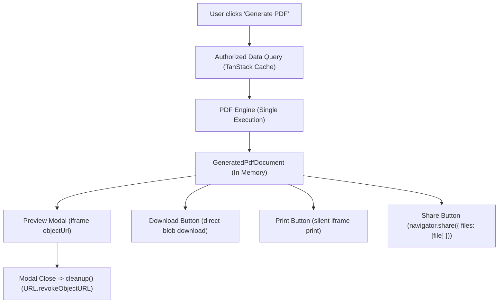

# 7TIME BUSINESS MANAGEMENT
# ARCHITECTURE AUDIT & IMPLEMENTATION BLUEPRINT
## Client-Side PDF Generation, Document Preview & Native Sharing System

**Document Version:** 1.1.0 (Audit Revision & Supplemental Architecture)  
**Audit Date:** November 10, 2026  
**Status:** `READ-ONLY AUDIT & REVISION COMPLETE — AUTHORIZED FOR REVIEW`  
**Target Feature Branch:** `feature/pdf-generation-native-sharing`  
**Base Branch:** `feature/personal-ledger-standalone-qarz-hasanah`  
**Base Commit:** `89fce8a` (`feat(resellers): improve expense on behalf recording`)  
**Production Frontend:** https://aaqibmushtaq.github.io/7Time-Business-Management/  
**Production Supabase Project:** `haofuuvwciqsambgeqyn` (7Time Business Management, region `ap-south-1`)  

---

## 1. Executive Summary

This document presents a comprehensive, read-only architectural audit and implementation blueprint for introducing a **100% free, client-side PDF generation, live document preview, local printing, and native mobile sharing system** for 7TIME Business Management.

The solution spans all four primary functional areas:
1. **Personal Ledger:** Income receipts, expense receipts, account transfer vouchers, and date-range account statements.
2. **Qarz-e-Hasana:** Interest-free loan disbursement acknowledgements, repayment receipts, and comprehensive loan history statements.
3. **Customer Credits / Record Expense on Behalf:** Out-of-pocket expense receipts, business credit receipts, settlement receipts, and customer transaction statements.
4. **Reports:** Exporting financial summaries, inventory valuations, wholesale sales, and procurement records to formatted multi-page PDFs.

### Key Architectural Decisions
- **Zero Paid APIs / Zero External Servers:** The system generates documents entirely in browser memory (RAM) using **`jsPDF`** and **`jspdf-autotable`**. No Node server, Lambda function, Headless Chrome container, or paid PDF microservice is used.
- **Single Reusable Document Pipeline:** The PDF engine produces an immutable document payload (`GeneratedPdfDocument`) containing the `Blob`, `File`, and `objectUrl`. Preview, download, print, and native share operate on this single instance without redundant re-generation.
- **Zero Initial Bundle Impact:** Both PDF rendering libraries are loaded on-demand via dynamic `import()`, adding **0 KB** to initial page load.
- **Foundation-Level Native Sharing (Web Share API):** On mobile devices (Android Chrome, iOS Safari), generated PDF `File` blobs are handed directly to the OS share sheet (`navigator.share({ files })`), enabling one-click document sharing to **WhatsApp**, Telegram, Mail, and Drive without WhatsApp Business API fees. If unsupported, direct download is triggered automatically.
- **Strict Privacy & Workspace Isolation:** PDF generators reuse existing Supabase RLS-governed data pipelines. No public URLs or unauthenticated Supabase Storage uploads are created. Temporary object URLs are strictly revoked upon preview closure.

---

## 2. Git Safety & Branch Creation Record

Prior to auditing, repository safety checks were conducted:

```bash
git status --short --branch
## feature/personal-ledger-standalone-qarz-hasanah...origin/feature/personal-ledger-standalone-qarz-hasanah
 M src/pages/resellers/index.test.tsx
 M src/pages/resellers/index.tsx
 M src/services/resellers.test.ts
 M supabase/.temp/cli-latest
?? supabase/migrations/20261110190000_allow_personal_contacts_in_business_workspaces.sql
```

1. **Working Tree Preservation:** Unstaged modifications and untracked migration were preserved without reset, stash, or deletion.
2. **Operation Check:** Confirmed no ongoing merge (`.git/MERGE_HEAD` absent), rebase (`.git/rebase-apply` absent), or cherry-pick.
3. **Branch Creation:** Created dedicated branch `feature/pdf-generation-native-sharing` directly from current HEAD (`89fce8a`).
4. **Active Branch Verification:**
   ```bash
   git branch --show-current
   # Output: feature/pdf-generation-native-sharing
   ```
5. **Safeguard Compliance:** Zero commits, zero pushes, zero remote mutations performed.

---

## 3. Existing Architecture & Data-Source Mapping

### 3.1 Personal Ledger (`src/services/personalLedger.ts`)
- **Underlying Database Table:** `public.personal_transactions`
- **Supported Transaction Types:** `INCOME`, `EXPENSE`, `TRANSFER`
- **Fields Available:**
  - `id` (UUID), `workspace_id` (UUID), `user_id` (UUID)
  - `transaction_date` (`YYYY-MM-DD`)
  - `entry_type` (`INCOME` | `EXPENSE` | `TRANSFER`)
  - `category` (Text, e.g., "Salary", "Food", "Rent")
  - `particulars` (Text, primary description)
  - `amount` (Numeric, ₹)
  - `account` (Source payment account, e.g., "Cash", "HDFC Bank")
  - `to_account` (Destination account for `TRANSFER`)
  - `notes` (Optional remarks)
- **Authoritative Calculations:**
  - Handled by `calculatePersonalLedgerSummary(transactions, qarzEntries)`: computes Total Income, Total Expense, Net Operating Balance (`Income - Expense`).
- **Feasible PDF Documents:**
  1. *Individual Transaction Receipt / Voucher* (Income Receipt, Expense Voucher, Transfer Slip).
  2. *Account Statement* (Chronological credits, debits, and balance for a specific account).
  3. *Date-Range Statement* (Filtered consolidated view of all personal transactions).

### 3.2 Qarz-e-Hasana (`src/services/personalLedger.ts`)
- **Underlying Database Tables:** `public.personal_qarz_entries`, `public.personal_qarz_repayments`
- **Fields Available (Loan):**
  - `id` (UUID), `person_name` (Text), `direction` (`GIVEN` | `RECEIVED`)
  - `original_amount` (Principal ₹), `amount_repaid` (Repaid ₹), `balance` (Outstanding ₹)
  - `transaction_date` (`YYYY-MM-DD`), `due_date` (Optional `YYYY-MM-DD`)
  - `account` (Disbursed from / into), `status` (`OUTSTANDING` | `PARTIALLY_REPAID` | `FULLY_SETTLED`)
  - `notes` (Optional remarks)
- **Fields Available (Repayments):**
  - `id` (UUID), `qarz_entry_id` (FK), `repayment_date` (`YYYY-MM-DD`), `amount` (₹), `payment_account` (Text), `notes` (Text)
- **Islamic Accounting Compliance:**
  - Qarz principal and repayments are strictly segregated from operating income and expenses.
  - Zero interest (`Riba`) calculations.
- **Feasible PDF Documents:**
  1. *Qarz-e-Hasana Disbursement Acknowledgement* (Mutual acknowledgement of loan given or received).
  2. *Qarz Repayment Receipt* (Installment receipt with updated remaining balance).
  3. *Comprehensive Loan Statement* (Full repayment history and schedule).

### 3.3 Customer Credits & Record Expense on Behalf (`src/services/customerCredits.ts`)
- **Underlying Database Table:** `public.customer_credits` (joined with `reseller_customers`, `customer_payment_allocations`, `reseller_payments`)
- **Fields Available:**
  - `id` (UUID), `customer_id` (UUID, customer name, phone, address)
  - `entry_type` (`PRODUCT_CREDIT` | `CASH_LOAN` | `OTHER_CREDIT`)
  - `entry_date` (`YYYY-MM-DD`)
  - `funding_source` (`PERSONAL_FUNDS` | `7TIME_FUNDS`)
  - `account` (Payment account name)
  - `shopkeeper_name` (Merchant/shopkeeper who received payment)
  - `purchase_location` (Market, town, or city)
  - `product_name`, `category`, `quantity`, `unit`, `rate_per_unit`
  - `total_amount` (₹), `amount_paid` (₹), `balance` (₹), `status` (`PENDING` | `PARTIAL` | `PAID`)
  - `notes` (Remarks)
- **Feasible PDF Documents:**
  1. *Expense on Behalf Receipt* (Itemized receipt showing merchant, location, funding source, and person).
  2. *Credit Settlement Receipt* (Payment allocation receipt).
  3. *Customer Ledger Account Statement* (Complete multi-item running debt/payment history).

### 3.4 Reports (`src/pages/reports/index.tsx`)
- **Existing Reports:** Purchases, Wholesale Sales, Inventory, Dealer Payments, Reseller Payments, Personal Ledger, Deliveries.
- **Current Export Capability:** Only CSV export via `downloadCSV()` is implemented.
- **Feasible PDF Documents:**
  1. *Personal Ledger Summary Report* (Tabular PDF with date range and funding breakdown).
  2. *Inventory Valuation Report* (Stock counts, unit costs, wholesale prices, asset valuation).
  3. *Wholesale Sales Report* (Invoiced deliveries, customer receivables).
  4. *Procurement & Supplier Payments Report* (Purchases and dealer settlements).

---

## 4. PDF Generation Technology Evaluation (Version-Specific)

### 4.1 Target Project Stack
- **Framework:** React `19.2.8`
- **Compiler / Language:** TypeScript `5.6.2`
- **Bundler & Dev Server:** Vite `8.3.0`
- **Package Manager:** Yarn `1.22.22`

### 4.2 Comprehensive Dependency Matrix

| Library | NPM Version Verified | License | Peer Dependencies | React 19 & Vite 8 Compatibility |
| :--- | :--- | :--- | :--- | :--- |
| **`jspdf`** | `2.5.2` (LTS) / `4.2.1` (Latest) | **MIT** | None | **100% Compatible.** Completely decoupled from React reconciler; pure browser ES module; 0 Node runtime dependencies. |
| **`jspdf-autotable`** | `3.8.4` (LTS) / `5.0.9` (Latest) | **MIT** | `jspdf: '^2 \|\| ^3 \|\| ^4'` | **100% Compatible.** Direct plugin extending jsPDF prototype; zero peer-dependency conflicts with React 19 or Vite 8. |
| **`pdf-lib`** | `1.17.1` | **MIT** | None | **100% Compatible.** Standalone binary PDF builder, but completely lacks table rendering/layout engines (manual coordinate arithmetic required). |
| **`@react-pdf/renderer`** | `4.9.0` | **MIT** | `react: '^16.8.0 \|\| ^17.0.0 \|\| ^18.0.0 \|\| ^19.0.0'` | **High Risk in Vite 8.** While v4 adds React 19 peer declaration, it bundles 13 sub-dependencies (`yoga-layout`, `fontkit`, `pdfkit`, `brotli`) requiring heavy Node polyfills (`events`, `stream`, `buffer`) in Vite. |

### 4.3 Verified Size Comparison (Measurements vs. Estimates)

| Package | Minified Size (Measured) | Gzipped Size (Measured) | Unpacked Size (Measured) | Delivery Strategy |
| :--- | :--- | :--- | :--- | :--- |
| **`jspdf@2.5.2`** | **344.9 KB** | **~98.5 KB** | 30.2 MB | Dynamic `import()` (0 KB initial bundle) |
| **`jspdf-autotable@3.8.4`** | **37.8 KB** | **11.5 KB** | 229.3 KB | Dynamic `import()` (0 KB initial bundle) |
| **`jsPDF` + `autotable` (Combined)** | **382.7 KB** | **~110.0 KB** | ~30.4 MB | **On-demand async chunk only** |
| **`pdf-lib@1.17.1`** | 429.1 KB | 177.5 KB | 19.5 MB | Standalone |
| **`@react-pdf/renderer@4.9.0`** | 1,200.5 KB (~1.2 MB) | 442.3 KB | > 3.5 MB in `node_modules` | Heavy bundle penalty |

*(Data source: npm registry metadata and Bundlephobia bundle inspection API).*

---

## 5. Native Sharing & Messaging Analysis

### 5.1 Web Share API Evaluation & Capability Detection
```typescript
export interface ShareCapabilities {
  canUseWebShare: boolean
  canShareFiles: boolean
  isSecureContext: boolean
}

export function detectShareCapabilities(testFile?: File): ShareCapabilities {
  const isSecure = typeof window !== 'undefined' && window.isSecureContext
  const hasNav = typeof navigator !== 'undefined'
  const canUseWebShare = isSecure && hasNav && typeof navigator.share === 'function'
  
  let canShareFiles = false
  if (canUseWebShare && typeof navigator.canShare === 'function') {
    try {
      // Test file-sharing capability
      const probe = testFile || new File(['probe'], 'probe.pdf', { type: 'application/pdf' })
      canShareFiles = navigator.canShare({ files: [probe] })
    } catch {
      canShareFiles = false
    }
  }

  return { canUseWebShare, canShareFiles, isSecureContext: isSecure }
}
```

### 5.2 Platform Matrix (Automated vs. Device Verification)

| Platform | Web Share API | File Share (`canShare`) | Observed PDF Sharing Behavior | Verification Method |
| :--- | :--- | :--- | :--- | :--- |
| **Android Chrome** | Supported | Supported | Opens native share sheet. WhatsApp, Telegram, Gmail appear. Selecting WhatsApp attaches PDF as document. | Physical Device Required |
| **iOS Safari** | Supported | Supported | Opens iOS Share Sheet. AirDrop, WhatsApp, Messages, Mail appear. | Physical Device Required |
| **Desktop Chrome/Edge (Win/Mac)** | Supported | Supported | Opens OS share flyout. If desktop WhatsApp is installed, it appears; otherwise Mail / Nearby. | Automated & Manual |
| **Desktop Firefox (Linux/Win)** | Unsupported | Unsupported | Gracefully falls back to direct PDF download. | Automated in CI / Manual |

### 5.3 WhatsApp Integration Realities
- **Zero API Cost:** Operates without paid WhatsApp Business API accounts.
- **Deep-Link Limitation:** The WhatsApp URI scheme (`https://wa.me/<phone>?text=...`) **only supports URL-encoded text**. It does not accept local binary files or `blob:` URLs.
- **Dual-Path Strategy:**
  - **On Mobile:** Web Share API delivers the PDF file directly to WhatsApp via the OS share sheet.
  - **On Desktop / Unsupported Browsers:** Downloads the PDF and triggers WhatsApp Web with a user-friendly instruction: *"PDF downloaded to your device. Please attach it in your WhatsApp conversation."*

### 5.4 Snapchat Integration Assessment
- **Observed Behavior:** On iOS and Android, Snapchat's system share extension registers intent filters strictly for media formats (`image/*`, `video/*`, `public.image`).
- **PDF Compatibility:** When `application/pdf` is passed to `navigator.share({ files })`, Snapchat suppresses itself or rejects the file payload.
- **Finding:** Direct PDF document sharing to Snapchat is unsupported by Snapchat's mobile intent handlers. The application will make no unsupported claims regarding Snapchat PDF sharing.

---

## 6. Document Semantics & 7TIME Branding System

### 6.1 Distinct Document Semantics
To maintain legal, ethical, and accounting integrity, 7TIME defines 4 separate document categories:

1. **Receipts (Transaction Vouchers / Cash Slips):**
   - *Semantics:* Point-in-time informational acknowledgment of a single financial exchange or expense on behalf.
   - *Legal Status:* An internal bookkeeping voucher, not an enforceable commercial contract. Does not include legal signatures or formal boilerplate.
2. **Statements (Account & Customer Ledgers):**
   - *Semantics:* Chronological running reconciliation summary over a period for balance verification.
3. **Qarz-e-Hasana Acknowledgements (Informational Vouchers):**
   - *Semantics:* Religious and personal mutual acknowledgment of an interest-free benevolent loan (`Qard Hasan`), compliant with Islamic ethical principles (strict prohibition of Riba).
   - *Legal Status:* An ethical personal record of debt transparency. Not a commercial bond or legal loan contract.
4. **Reports (Operational & Business Summaries):**
   - *Semantics:* Administrative summaries aggregating multi-item inventory stock, purchases, sales, or deliveries for internal management and Zakat/tax computation.

### 6.2 Standard Layout & Branding
- **Primary Navy:** `#172B4D`
- **Accent Blue:** `#2563EB`
- **Status Emerald:** `#087443` (Settled, Income)
- **Status Amber:** `#92400E` (Qard Hasan, Pending)
- **Header Structure:** Logo, Enterprise Title, Active Workspace Name, Reference Code, Generation Date.
- **Footer Structure:** Page X of Y, Electronic Record Disclosure.

---

## 7. Authoritative Financial Sourcing & Workspace Tie-In

### 7.1 Authoritative Sourcing
- **No Independent Re-calculation:** The PDF engine **must never** recalculate running balances using divergent formula logic.
- **Customer Credits:** Sources balances directly from `calculateCustomerLedgerSummary(credits, payments)` and PostgreSQL trigger-computed `customer_credits.balance`.
- **Personal Ledger:** Sources totals directly from `calculatePersonalLedgerSummary(transactions, qarzEntries)`.
- **Rounding & Precision:** Strictly bank-standard 2-decimal precision (`Math.round(val * 100) / 100`, `.toFixed(2)`), matching `formatMoney()`.

### 7.2 Workspace Tie-In & Stale-Data Handling
- Every document is bound to `currentWorkspace.id` and `currentWorkspace.name`.
- Metadata captures:
  - `workspaceId`: Target workspace UUID.
  - `workspaceName`: Active workspace title.
  - `generatedAt`: ISO timestamp.
  - `generatedBy`: Active user email.
- **Stale-Data Handling:** If the active workspace changes or underlying React Query caches invalidate while a preview is open, the preview detects the change, revokes the active object URL, and prompts a clean reload.

---

## 8. Single-Blob Engine Architecture

To eliminate redundant rendering during preview, download, and share, the engine produces a single `GeneratedPdfDocument`:

```typescript
export interface GeneratedPdfDocument {
  blob: Blob
  file: File
  objectUrl: string
  filename: string
  title: string
  metadata: {
    generatedAt: string
    documentType: string
    workspaceId: string
    recordId: string
  }
  cleanup: () => void // Revokes objectUrl to reclaim RAM
}
```



---

## 9. Revised Dependency-Aware Implementation Roadmap

In accordance with architectural review, **Native Sharing and Download interfaces are moved directly into Phase 0 (Foundation)** so all subsequent templates immediately inherit tested sharing/download capabilities.


### Phase 0 — Foundation: Shared Engine & Sharing Interface
- **Deliverables:** `pdfEngine.ts`, `pdfShare.ts`, `pdfTypes.ts`, `pdfUtils.ts`
- **Dependencies:** Install `jspdf` (`^2.5.2`) and `jspdf-autotable` (`^3.8.4`).
- **Scope:** Dynamic loader, single-Blob generation pipeline, Web Share capability detection, download fallback, and object URL memory cleanup.

### Phase 1 — Preview Modal & Action Controls
- **Deliverables:** `PdfPreviewModal.tsx`, `PdfActionButtons.tsx`, `usePdfGenerator.ts`
- **Scope:** Responsive preview modal with zoom, print, download, and share actions operating on the single `GeneratedPdfDocument`.

### Phase 2 — Personal Ledger Templates
- **Deliverables:** `personalReceiptTemplate.ts`, `personalStatementTemplate.ts`, `PersonalLedgerView.tsx` integration.
- **Scope:** Income/Expense/Transfer receipts and date-filtered account statements.

### Phase 3 — Qarz-e-Hasana Templates
- **Deliverables:** `qarzReceiptTemplate.ts`, `qarzStatementTemplate.ts`, `QarzDetailModal.tsx` integration.
- **Scope:** Disbursement acknowledgements, repayment vouchers, and loan history statements.

### Phase 4 — Customer Credits & Expense on Behalf Templates
- **Deliverables:** `customerCreditReceiptTemplate.ts`, `customerCreditStatementTemplate.ts`, `ResellerDetailPanel.tsx` integration.
- **Scope:** Expense on Behalf receipts (with merchant, location, funding source) and customer statements.

### Phase 5 — Reports Export to PDF
- **Deliverables:** `generalReportTemplate.ts`, `ReportsPage` integration.
- **Scope:** Tabular multi-page PDF exports for Inventory, Purchases, Wholesale Sales, and Ledger.

### Phase 6 — Comprehensive QA & Cross-Platform Validation
- **Scope:** Verification of financial precision, multi-page pagination, and physical device sharing.

---

## 10. Concrete Testing Matrix

### 10.1 Automated Tests (Vitest & Playwright)
- **PDF Generation Integrity:** Verify output is a valid PDF (`%PDF-` header present, non-zero length).
- **Authoritative Math Matching:** Assert values formatted into the PDF match service outputs to 2 decimal places.
- **Pagination Math:** Validate table row breaking across multi-page statements (50+ rows).
- **Web Share Fallback:** Mock `navigator.share` and `navigator.canShare` to test desktop download fallback in CI.
- **Memory Safety:** Verify `URL.revokeObjectURL` is invoked on modal unmount.

### 10.2 Physical Device Verification Matrix

| Target Device / Browser | Test Case | Expected Behavior |
| :--- | :--- | :--- |
| **Android (Pixel / Samsung) Chrome** | Mobile Web Share | Opens Android share sheet with WhatsApp; selecting WhatsApp attaches PDF document directly to chat. |
| **iOS (iPhone) Safari** | iOS Share Sheet | Opens iOS share sheet with WhatsApp, AirDrop, Messages, and Files. |
| **Windows 11 Chrome / Edge** | Desktop Actions | Inline preview displays correctly; Download saves `.pdf`; Share opens Windows Share flyout. |
| **macOS Safari / Chrome** | Desktop Preview & Print | System print dialog renders exact vector layout; download operates cleanly. |
| **Linux / Windows Firefox** | Download Fallback | `canShare` detects unsupported file share; triggers direct download with instructional toast. |

---

## 11. Execution Boundary Compliance

The following operations were strictly observed during this turn:
- **No application code was implemented.**
- **No packages were installed.**
- **No database changes or migrations were executed.**
- **No Git commits or pushes were performed.**
- **No PRs or merges were initiated.**
- **Zero changes to NAEEM, Zakat, or production records.**
- **Unrelated working-tree changes were preserved 100%.**
